# FamilyMission for Home Assistant

<p align="center"></p>

> **Credits:** FamilyMission is based on [**TaskOrganizer**](https://github.com/patrickvonwiegen/TaskOrganizer) by Patrick von Wiegen (MIT license). It continues as a project of its own, maintained by [AndyKausG](https://github.com/AndyKausG), and can be installed **next to** TaskOrganizer without any conflict.

FamilyMission turns household chores into **family missions**: small tasks with points, time windows and instant feedback. Kids tick off their missions on a wall tablet (with a PIN, no Home Assistant account needed), collect points in a wallet, spend them in a reward shop and fill a cooperative family goal together. Parents approve, praise and adjust everything from their phone.

Suggestions for improvement and bug reports are welcome: [issues](https://github.com/AndyKausG/FamilyMission/issues).

**Quick links:** [Installation](#installation) · [Recommended dashboard](#recommended-dashboard) · [Kids mode](#kids-mode) · [Parents card](#parents-card-family-mission-parents) · [Parents guide](#parents-guide-in-app-help) · [Migration from TaskOrganizer](#migration-from-taskorganizer)

## What is FamilyMission?

FamilyMission is a motivating family system for kids (about 6-12) that runs inside Home Assistant: the kids tick off their missions on a wall tablet, the parents run everything from the parents' hub on their phone. The guiding principle is **set up once, then just tick off**: the quick-start wizard proposes an age-appropriate setup, and after that the daily routine is a few taps. Instead of ranking siblings against each other, the whole family fills **one shared family goal**, which ends in a countdown and a rocket launch on the tablet. The adults' own household and planning work lives in the same system as quiet **parent tasks without points** ("We parents"), so the kids see that Mom and Dad have missions, too. At night the tablet turns into a sleep buddy with an alarm clock.

<p align="center">
  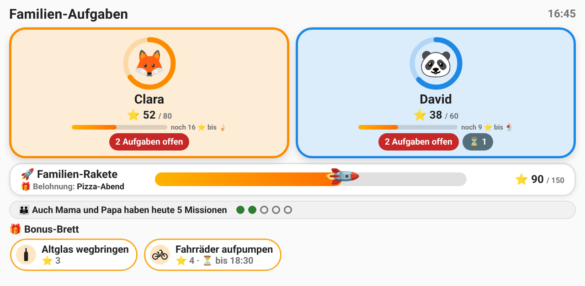<br>
  <em>The wall tablet: one tile per kid, the family rocket, the role-model band and the bonus board.</em>
</p>

<table align="center">
  <tr>
    <td align="center" valign="top">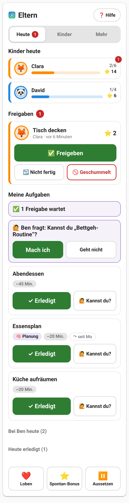<br><em>Parents' hub: today at a glance</em></td>
    <td align="center" valign="top">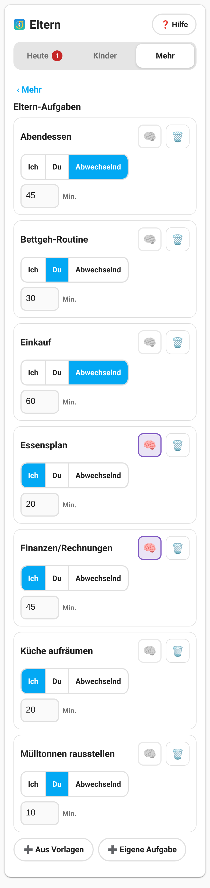<br><em>Parent tasks: me / you / take turns</em></td>
    <td align="center" valign="top">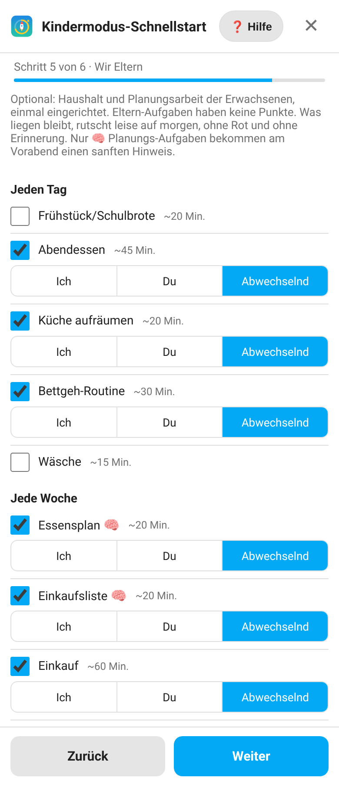<br><em>Quick start: step "We parents"</em></td>
  </tr>
</table>

<table align="center">
  <tr>
    <td align="center" valign="top">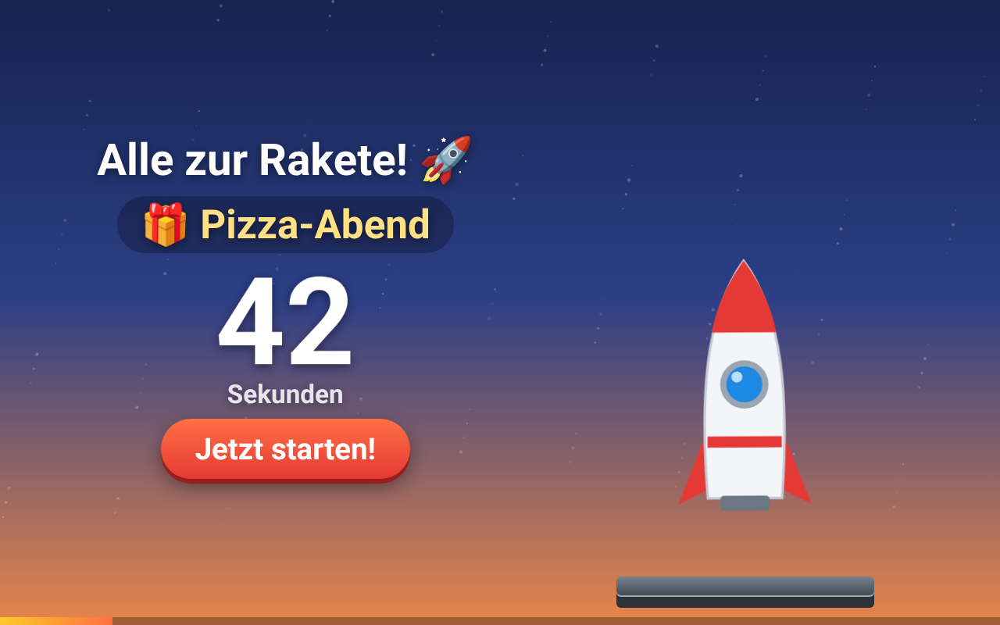<br><em>Family goal reached: the rocket countdown</em></td>
    <td align="center" valign="top">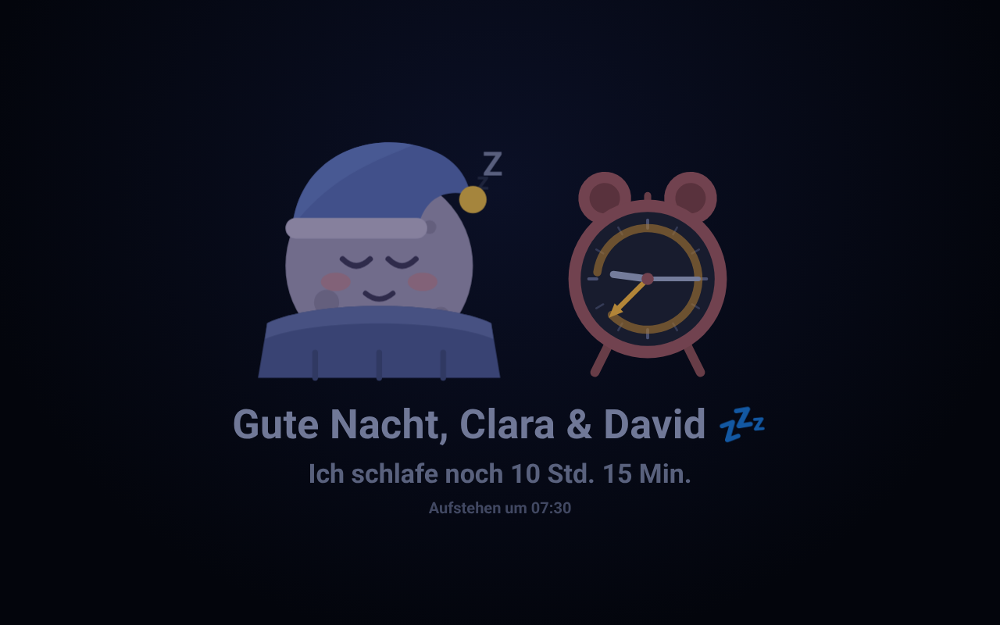<br><em>Night mode: sleep buddy with alarm clock</em></td>
  </tr>
</table>

## Features

* **Family missions**: tasks with intervals, complexity points, subtasks (progress in %), one-time and recurring tasks, templates, categories (`basis` duty, `bonus`, `auftrag`) and a minimum age.
* **Kids' wall tablet with PIN**: one big tile per kid with a progress ring, PIN pad, personal task and bonus view, confetti and sounds, auto-return to the home screen. See [Kids mode](#kids-mode).
* **Parents' hub and roles**: one phone card with the tabs Today / Kids / More: approvals, "not done" / "cheated", bonus points and deductions, undo, praise, parent tasks, task list, shop and settings, plus a role model (admin, manager, parent). See [Parents card](#parents-card-family-mission-parents) and [Parents role](#parents-role).
* **Reward shop**: a per-kid wallet that survives the monthly reset, configurable rewards, a savings goal, redemptions that parents approve from a push notification. See [Reward shop](#reward-shop).
* **Praise**: a sticker and a friendly message instead of points. See [Praise](#praise).
* **Quick-start wizard**: proposes an age-appropriate setup (tasks, rotation, goals) from a built-in catalog and creates everything in one click. See [Kids mode quick-start wizard](#kids-mode-quick-start-wizard).
* **Time windows**: duties are only available at the right time of day; missed duties expire at midnight. See [Time windows](#time-windows).
* **Reminders**: per task a time of day; an event and an optional `notify.*` call for open tasks. See [Task reminders](#task-reminders).
* **Own-device view** (`mode: mine`): kids and adults see their own tasks on their own phone, without tiles and PIN. See [My tasks](#my-tasks-own-device-mode-mine).
* **Monthly goals, family rocket, reports and history protocol** with editable entries.
* **We parents (new in 2.0)**: the adults' household and planning work as quiet, point-free parent tasks (me / you / take turns, "Can you?" hand-over by push, 🧠 planning reminder, Sunday summary) plus a role-model band on the kids tablet. See [We parents](#we-parents-parent-tasks).
* **Rocket launch and night mode (new in 2.1)**: reaching the family goal triggers a shared "All aboard the rocket!" countdown with liftoff on the wall tablet (once per goal, push to the adults); at night the tablet sleeps with a sleeping buddy and an analogue alarm clock, and greets the family in the morning. See [Rocket launch and night mode](#rocket-launch-and-night-mode).
* **Push safety**: approvals must not sit unseen. The settings card shows the push target per adult with a "Test push" button, the hub warns when nobody can be reached, and one quiet reminder follows after a few hours. See [Parent approval](#parent-approval).
* **Bonus triggers**: a bonus task opens by itself when a device state changes (e.g. the dishwasher is done).
* **Waste collection bonus (new in 2.4)**: with the HACS integration *Waste Collection Schedule* the evening before a collection opens "Put the bins out", the evening of the collection day "Bring the bins in". Per bin released by the parents (glass can stay with you). See [Waste collection](#waste-collection).
* **Voice announcement (new in 2.4)**: new bonus tasks are spoken on your speakers ("Dad created a bonus task: carry up the shopping. 3 points."). See [Voice announcement](#voice-announcement).
* **Icon set `fm:`** and a ready-made [recommended dashboard](#recommended-dashboard).
* **In-app help in German, French and English** (the parents guide, searchable, offline). Also available as Markdown: [Deutsch](docs/parents-guide.de.md) · [English](docs/parents-guide.en.md) · [Français](docs/parents-guide.fr.md).

## Installation

### Option 1: HACS custom repository (recommended)
1. In HACS open the three-dot menu and choose **Custom repositories**.
2. Add `https://github.com/AndyKausG/FamilyMission` with the category **Integration**.
3. Search for "FamilyMission" in HACS, download it and restart Home Assistant.
4. Go to **Settings > Devices & services > Add integration** and add **FamilyMission**.

### Option 2: Manual
1. Open the directory of your Home Assistant configuration (where `configuration.yaml` is).
2. Create the directory `custom_components` if it does not exist.
3. Copy the folder `custom_components/family_mission/` of this repository into it.
4. Restart Home Assistant and add the integration as described above.

The cards are registered as Lovelace resources automatically (only FamilyMission's own files, `/family_mission_frontend/family-mission-*.js`; the resources of other integrations are never touched). A browser refresh may be needed after the first start.

## Recommended dashboard

A ready-made dashboard with a **Kids** view for the wall tablet and a **Parents** view for the phones. Create a new dashboard (**Settings > Dashboards > Add dashboard**), open it, choose the three-dot menu > **Edit dashboard** > three-dot menu > **Raw configuration editor** and paste the YAML below.

```yaml
title: Familie
views:
  - title: Kinder
    path: kinder
    icon: fm:rocket
    type: panel
    cards:
      - type: custom:family-mission-kids
        title: Familien-Aufgaben
        timeout: 90
        sound: true
        show_family_goal: true
        show_bonus_board: true
  - title: Eltern
    path: eltern
    icon: fm:parents
    type: sections
    max_columns: 2
    visible:
      - user: 0123456789abcdef0123456789abcdef
    sections:
      - type: grid
        cards:
          - type: custom:family-mission-parents
            title: Eltern
            grid_options:
              columns: full
            tasks_card:
              sort_by: due_date
              filter_by: '!paused'
              items_per_page: 10
              show_search: true
              show_add: true
              show_edit: true
              show_delete: true
            settings_card:
              show_advanced: false
      - type: grid
        cards:
          - type: heading
            heading: Protokoll & Auswertung
          - type: custom:family-mission-protocol
            title: Protokoll
          - type: custom:family-mission-stats
```

Notes:

* **Replace the placeholder user id** `0123456789abcdef0123456789abcdef` under `visible` with the id of each parent (Settings > People > the person > show the user id). Add one `- user:` line per parent. Without `visible` the kids could open the Parents view.
* **The tablet user must be neither an administrator nor in the parents role.** Otherwise the tablet keeps the normal view at night and does not go to sleep (see [Night mode](#night-mode)), and it could approve its own tasks. Make this dashboard the default dashboard of the tablet user (profile > dashboard setting) and open the `kinder` view.
* The icons `fm:rocket` and `fm:parents` come from the [icon set `fm:`](#icons-fm), which is registered automatically.
* The same dashboard with comments is in [`examples/kids/dashboard.yaml`](examples/kids/dashboard.yaml).

## Migration from TaskOrganizer

FamilyMission uses its own domain (`family_mission`), its own storage (`.storage/family_mission.storage`) and its own card, service and event names, so it runs **next to** an installed TaskOrganizer.

**Automatic takeover.** When FamilyMission starts for the first time and has no data of its own (no tasks, history and points), it looks for the storage of TaskOrganizer (`.storage/task_organizer.storage`) and **copies** everything: tasks, templates, history, points, wallet, redemptions, pending approvals, praise, monthly history and all other stored keys. The options of an existing TaskOrganizer config entry (settings, kid profiles including PIN hashes, parents and roles, rewards, goals, bonus triggers, wizard memory, ...) are copied into FamilyMission's entry as well, as long as its own options are still empty.

* TaskOrganizer's storage and config entry are only **read**, never changed or deleted.
* The takeover is marked in the data (`migrated_from`) and runs only once.
* A persistent notification tells you what to adapt (see the table below). Afterwards you can remove TaskOrganizer.

**Repeat on purpose.** The admin-only service `family_mission.import_from_task_organizer` replaces all FamilyMission data and settings with a fresh copy. It requires `overwrite: true`:

```yaml
action: family_mission.import_from_task_organizer
data:
  overwrite: true
```

**What you have to change by hand:**

| Where | TaskOrganizer (old) | FamilyMission (new) |
| :--- | :--- | :--- |
| Dashboard cards | `custom:task-organizer-card`, `-leaderboard`, `-protocol`, `-stats`, `-settings`, `-kids`, `-parents`, `-help` | `custom:family-mission-card`, `-protocol`, `-stats`, `-settings`, `-kids`, `-parents`, `-help` (there is no leaderboard card, see [Changelog](CHANGELOG.md)) |
| Services | `task_organizer.<service>` | `family_mission.<service>` |
| Events | `task_organizer_<event>` (e.g. `task_organizer_task_completed`) | `family_mission_<event>` |
| Push action prefixes | `TO_APPROVE_`, `TO_NOTDONE_`, `TO_CHEAT_`, `TO_RAPPROVE_`, `TO_RREJECT_` | `FM_APPROVE_`, `FM_NOTDONE_`, `FM_CHEAT_`, `FM_RAPPROVE_`, `FM_RREJECT_` |
| Websocket API | `task_organizer/<command>` | `family_mission/<command>` |
| Entities | `sensor.task_organizer_*`, `button.task_organizer_*` | `sensor.family_mission_*`, `button.family_mission_*` |

Entity ids of the new sensors differ from the old ones, so update dashboards and automations that reference them.

## Icons (fm:)

FamilyMission ships its own icon set `fm:`. It is registered as a custom icon set when the integration loads (as a dashboard resource and as an extra module), so the icons work everywhere in Home Assistant: dashboard views, sidebar, cards, entity icons and the icon picker (search "fm").

| Icon | Name | Use |
|------|------|-----|
| rocket | `fm:rocket` | The FamilyMission rocket: tasks, missions, the kids card |
| rocket in a ring | `fm:rocket-ring` | Progress ring with rocket: monthly goal and family rocket |
| sleeping moon | `fm:moon-buddy` | Night mode / sleep screen |
| parents | `fm:parents` | Parents card, "We parents" |

Example, a dashboard view with the rocket as its icon:

```yaml
views:
  - title: FamilyMission
    path: familymission
    icon: fm:rocket
    cards:
      - type: custom:family-mission-parents
```

The app icon and the logo are shown discreetly in the parents' hub, the help, the quick-start wizard and at the bottom of the settings card (not on the kids' tablet).

## Dashboard Cards
The integration ships these cards for the Lovelace dashboard (`custom:family-mission-card`, `-protocol`, `-stats`, `-settings`, `-kids`, `-parents`, `-help`). The ready-to-paste [recommended dashboard](#recommended-dashboard) with a kids view and a parents view is the quickest start; a commented variant is in [`examples/kids/dashboard.yaml`](examples/kids/dashboard.yaml).

### 1. Household Tasks (`family-mission-card`)
The main card for viewing and completing tasks.


**YAML Configuration:**
```yaml
type: custom:family-mission-card
title: "Household Tasks" # Custom title for the card (Default: Household Tasks)
sort_by: due_date        # Options: due_date, points, assignee, alphabet (default due_date)
sort_order: desc         # Options: default, asc, desc (default default)
filter_by: none          # Options: see filter options below
items_per_page: 10       # Number of displayed items
show_edit: true          # Shows the task edit symbol (Default true)
show_delete: true        # Shows the task delete symbol (Default true)
show_search: true        # Shows the search icon and bar (Default true)
show_add: true           # Shows the add task button (Default true)
```

#### Available Filters:
 Multiple filters are AND-linked.
 Supports comma-separated lists and negations (!), e.g. "!done, !paused". 
- `current_user`: Tasks assigned to the currently logged-in Home Assistant user.
- `assigned`: Tasks that have at least one assignee.
- `done`: Tasks where the next due date is in the future.
- `due`: Tasks that are due today or in the past, but not yet overdue.
- `overdue`: Tasks that have exceeded their overdue threshold.
- `paused`: Tasks that are currently paused until a specific date. You can use `!paused` to only show active tasks.
- `onetime`: Tasks that do not repeat.
- `room:[area_id]`: Tasks assigned to a specific area (e.g., `room:kitchen`, `room:living_room`).

#### Filter Examples:
- `filter_by: "current_user, due"` (Only my due tasks)
- `filter_by: "overdue"` (All overdue tasks)
- `filter_by: "done"` (All completed tasks, where the next due date is in the future)
- `filter_by: "!due, !paused"` (All active tasks except due ones)
- `filter_by: "!assigned, !done"` (All unassigned tasks that are due or overdue)
- `filter_by: "!done, !paused"` (All active tasks that are due or overdue)
- `filter_by: "onetime, !done"` (All pending one-time tasks)
- `filter_by: "room:kitchen, overdue"` (All overdue tasks in the kitchen)

### 2. Household Log (family-mission-protocol)
A list of recently completed tasks with the option to correct or delete entries.


**YAML Configuration:**
```yaml
type: custom:family-mission-protocol
title: "Who did what?"
filter_by: all      # Options: all (Default all)
items_per_page: 10  # Number of displayed items
```

### 3. Reports (family-mission-stats)
Provides advanced reporting with different views like "Completed Tasks" and "Goal Setting", including monthly point charts and progress tracking.


**YAML Configuration:**
```yaml
type: custom:family-mission-stats
title: "Reports"
report_type: overview  # Options: overview, burndown
show_user_select: true # Allows selecting a specific user
```

### 4. Settings (family-mission-settings)
Allows customization of colors, data export, and factory resets.


**YAML Configuration:**
```yaml
type: custom:family-mission-settings
show_advanced: false    # Unlocks the reset and factory reset area (Default: false)
```

### 5. Kids (family-mission-kids)
A big, colourful, touch-friendly card for a tablet in landscape mode (designed for 1280x800). See [Kids mode](#kids-mode) for the concept and the setup.

**YAML Configuration:**
```yaml
type: custom:family-mission-kids
title: Family Tasks        # Optional
timeout: 90                # Seconds of inactivity until the card returns to the home screen (Default: 90)
sound: true                # Cheerful sounds generated with WebAudio (Default: true)
show_family_goal: true     # Show the "family rocket" progress bar (Default: true)
show_bonus_board: true     # Show the bonus board with currently open bonus tasks (Default: true)
return_home_after_done: true  # Return to the home screen after "Done!" (Default: true)
mode: family               # "family" = shared tablet with tiles and PIN (Default), "mine" = own device, see "My tasks"
```
On a phone (card width below 700 px, measured on the card itself, not on the screen) the card switches to a compact layout: two kid tiles per row, one column in the kid view (own tasks first, bonus below), an icon-only back button and a full-width "Done!" button below the subtasks. The tablet layout is unchanged. On a tall panel the tiles keep their natural height (at most about 380 px) and the family rocket and the bonus board follow directly below.

Use it in a dashboard view of type `panel` (full screen), see the [recommended dashboard](#recommended-dashboard) or [`examples/kids/dashboard.yaml`](examples/kids/dashboard.yaml).

<p align="center">
  <br>
  <em>Home screen: kid tiles with progress rings, family rocket, role-model band, bonus board.</em>
</p>
<p align="center">
  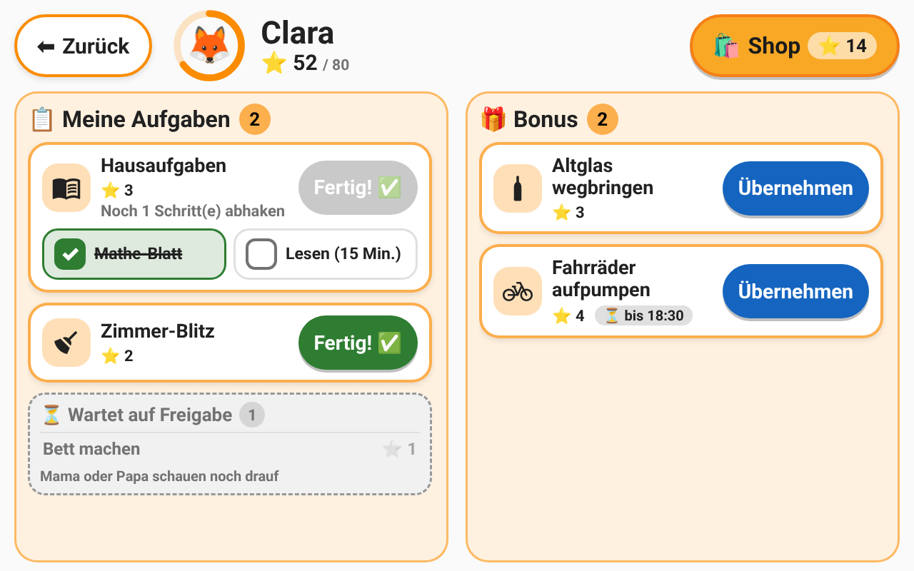<br>
  <em>Kid view: own tasks with steps, and the bonus tasks.</em>
</p>

### 6. Parents (family-mission-parents)
The **parents' hub** for phones in three tabs (Today / Kids / More): approvals, bonus points and deductions, praise, parent tasks, task list, reward shop and settings. See [Parents card](#parents-card-family-mission-parents), [Parent approval](#parent-approval) and [We parents](#we-parents-parent-tasks).

### 7. Help (family-mission-help)
The searchable parents guide as a card (`type: custom:family-mission-help`, optional `anchor`), see [Parents guide](#parents-guide-in-app-help).

## Kids mode
Kids mode turns FamilyMission into a motivating family system for kids (designed for ages 6-12): immediate visual rewards, personal progress instead of ranking siblings, one cooperative family goal and optional "first duties, then bonus".

**Typical setup:** one wall tablet (e.g. an Android tablet with Fully Kiosk Browser) that is permanently logged in as a single Home Assistant user (e.g. "Tablet", neither an admin nor in the parents role, otherwise night mode does not sleep) and shows the kids card. The parents use their own admin users on their phones.

### Parents guide (in-app help)
A practical guide for parents (basic idea, 10-minute setup, ramp-up weeks, daily routine, approvals, choosing rewards, praising, goals, We parents, phasing out, FAQ) in German, French and English:

* In Home Assistant: the **❓ Hilfe** buttons of the parents card, the Kids section of the settings card and the quick-start wizard open it as a full-screen overlay at the matching chapter (table of contents, collapsible chapters, search, works offline; language from your Home Assistant profile, fallback English). It can also be placed as a card: `type: custom:family-mission-help` (optional `anchor: ramp` to open a chapter).
* As documents: [Deutsch](docs/parents-guide.de.md) · [Français](docs/parents-guide.fr.md) · [English](docs/parents-guide.en.md).

<p align="center">
  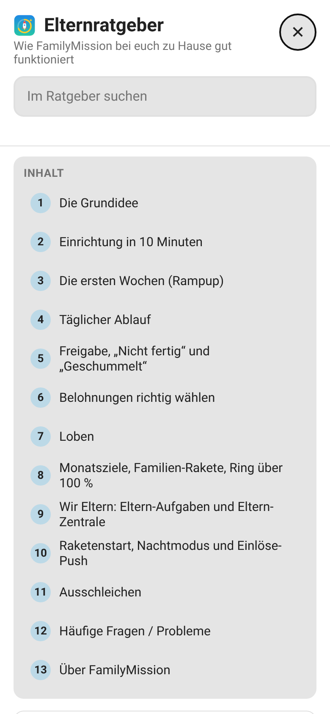<br>
  <em>The in-app parents guide.</em>
</p>

### Kids do not need a Home Assistant user
Kids are `person` entities. The *participant ID* used for points, history and assignees is the `user_id` attribute of the person if there is one, otherwise the entity id (e.g. `person.anna`). Existing data that is keyed by user id keeps working unchanged. All cards (task list, protocol, reports, settings) and the services (`assignees`, `complete_task_by_name`) understand both kinds of IDs.

### Setup
1. Create a `person` entity per kid (no user account required).
2. Open the **settings card** and expand **Kids**: enable a person as a kid, choose an emoji avatar and colour, set the birth year and an optional 4-digit PIN. The monthly point goal of each kid is edited there, too (it is the same `point_goals` setting as before). Also set the **family goal** (points per month for all kids together and the reward text), the bonus reservation time and whether bonus tasks require finished duties. Only administrators can change kid profiles and PINs.
3. Give every task or template a **category** and a **minimum age** (task editor, template editor, or the `category` / `min_age` fields of the services):

| Category | Meaning |
| :--- | :--- |
| `basis` (default) | A duty that is assigned to a kid and recurs (e.g. "Set the table"). |
| `bonus` | Not assigned, opened by an automation with `family_mission.set_task_due_by_name`; the first kid who takes it gets it (first come, first served). |
| `auftrag` | One-time job assigned by a parent. |

`min_age` (0-18) hides a task from kids who are too young (age = current year - birth year). Tasks created before this feature behave like `basis` tasks with `min_age` 0. The example templates in [`examples/kids/vorlagen.yaml`](examples/kids/vorlagen.yaml) already contain both fields; bonus automations are in [`examples/kids/automationen.yaml`](examples/kids/automationen.yaml).
4. Or skip steps 2-3 and let the [quick-start wizard](#kids-mode-quick-start-wizard) propose and create tasks, goals and profiles for you.
5. Add the kids card to a full-screen (`panel`) dashboard view, see the [recommended dashboard](#recommended-dashboard).

### Kids mode quick-start wizard
Creating 40 tasks per family by hand is tedious and it is hard to know how many points a good goal is. The wizard proposes a complete, age-appropriate setup and creates everything in one click. Open the **settings card**, expand **Kids** and press **🚀 Kids mode quick start** (administrators only; works on a phone, too).

1. **Kids:** all `person` entities are listed. Switch the kids on, enter the birth year and pick an avatar and colour (existing profiles are pre-filled; persons with a Home Assistant user, i.e. the parents, are off by default).
2. **Household:** school, dishwasher, tumble dryer, washing machine, robot vacuum, garden, driveway, pets. Only matching tasks are proposed. The **household day** (default Saturday) is the weekday on which weekly and bi-weekly duties are first due instead of the start date (bi-weekly duties alternate between kids). For dishwasher, dryer, washing machine and robot vacuum you can optionally choose an entity and a target state that opens the matching bonus task automatically (see [Bonus triggers](#bonus-triggers)). Also choose the start date.
3. **Tasks:** one column per kid with the proposed tasks as switches, the points (1-10, with a stepper) and the interval. A load bar shows the estimated minutes per day against the recommendation for the age (ages 6-7: 20 min, 8-9: 30 min, 10+: 40 min) and turns amber when it is too much. Shared duties (set/clear the table, load the dishwasher, water the plants, ...) **rotate** among all eligible kids, the oldest kid starts: with 4 kids "Set the table" becomes one task per kid with an interval of 4 days whose first due dates are one day apart. Bonus tasks (shared, unassigned) and *Aufträge* (created as templates only) are listed below.
4. **Goals:** *start phase* (60 % of the points a kid can maximally earn per month, easy to reach so the kids experience success) or *normal* (75 %). Per-kid goals are pre-computed and editable (rounded to 5, prorated by the remaining days if the start date is not the 1st of the month). The family goal is 80 % of the sum of the kid goals (rounded to 10); choose the reward text.
5. **Summary:** counts, the prorated goal with the full goal that applies from the next month ("from 1.11.: 150 pts") and the option *Update earlier wizard tasks* (default on if the wizard created tasks before). *Create* writes everything at once; the success screen lists the next steps (set PINs, tablet dashboard).

What is created:
* **Basis tasks per kid**, e.g. "Morning mission Anna" (subtasks are filtered by age, e.g. vacuuming only from age 8), daily and weekly tasks, each with `category: basis`, `min_age` and the kid as the assignee.
* **Rotation tasks** for the shared duties (one task per kid, staggered due dates).
* **Open bonus tasks** (e.g. "Unload the dishwasher", "Empty the dryer + fold", "Take out the trash"): unassigned, interval 365 days and *not due yet*. They become due through a [bonus trigger](#bonus-triggers) or your own automation (`family_mission.set_task_due_by_name`).
* **Auftrag templates** ("Help with cooking", "Vacuum the car", "Clean the windows", "Clean the bathroom sink") as templates only; create the task when you need it (new "From template" dropdown in the task editor).
* The kid profiles (birth year, avatar, colour; an existing PIN is kept), the monthly goals `point_goals` and the `family_goal`.

**Spreading over the day and the week:** every basis task gets a default time window from the catalog (`available_from` / `available_until`): morning mission 05:00-10:00, evening mission 17:00-21:00, room blitz 14:00-19:30, set the table 17:00-19:30, clear the table 18:00-20:30, load the dishwasher 18:00-21:00, water the plants 14:00-19:00, own laundry 14:00-19:30, thorough room clean and bedding 09:00-18:00, garden, driveway and cage / litter box 10:00-18:00, feed the pets 07:00-19:00. In the kids card, duties whose window has not opened yet are listed after the currently available ones (by start time), duties that are over for today last. Weekly duties of one kid are spread around the household day: the thorough room clean is due on the household day, *Put away own laundry* the day before (the following week if that day would lie before the start date), *Strip the bedding* (every 2 weeks, alternating by kid) the day after; weekly rotations (garden, driveway, plants, cage) keep the rotation stagger from the household day. A daily duty that would start today although today's window is over starts tomorrow.

**Replaced on the deep-clean day:** a catalog entry can declare `replaced_by`; the room blitz (5 and 10 minutes) is replaced by the thorough room clean. Wizard tasks store this as `replaced_by_key` (wizard key prefix of the replacing task; older wizard tasks get it automatically). While the same kid's thorough room clean is due / open, the blitz is not shown as a duty (the kid view shows a small muted line "Today: thorough room clean instead of room blitz"), does not count as an open duty (home badge, bonus lock), cannot be completed (`not_eligible`) and is skipped without points and without a "missed" history entry - at midnight and when the room clean is completed (today's blitz moves to its next occurrence). Tasks without `replaced_by_key` are unaffected.

Every generated task carries `generated_by: "wizard"` and a `wizard_key` (`<catalog key>:<kid id>`, or `<catalog key>:open`). With *Update earlier wizard tasks* (`replace_existing`) a re-run does **not** reset the day: a task with an existing `wizard_key` is updated in place (name, points, icon, subtasks definition, category, minimum age, time window, interval) and keeps its due date, pause, reservation and subtask progress; only new keys are created and wizard tasks that are no longer selected are removed. If the members or the length of a rotation changed, its turns are staggered again starting tomorrow (or the next household day for weekly rotations), never today. Your own tasks, the points and the history are never touched. With the additional option *Redistribute due dates* (`reschedule`, default off, only together with the in-place update) existing wizard tasks get fresh due dates exactly like in a new plan (household day for weekly tasks, rotation stagger, daily tasks today if their time window is still ahead, otherwise tomorrow) while points, history and progress are kept - useful for tasks that were created before the household day or the spreading rule existed. Without the option, tasks that already exist (same `wizard_key`) are skipped (to add a kid to an existing rotation, run the wizard again with *Update earlier wizard tasks* so that the intervals are rebalanced). The monthly goals of the start month are prorated: the unprorated goals are stored in `point_goals_full` with the month in `point_goals_prorated_month` and replace the prorated goals automatically in the next month (at the monthly reset and on startup); a goal entered manually in the settings card also becomes the full goal. Templates with the same name are not duplicated. The household features and your last choices are stored in the settings, so running the wizard again pre-fills everything.

| Command (**admin or manager**) | Description |
| :--- | :--- |
| `family_mission/wizard_catalog` | Task catalog (German and English names) and household features. |
| `family_mission/wizard_preview` | `kids` (`id`, `birth_year`, ...), `features`, `start_date`, `phase` (`start` / `normal`), optional `household_day` (0 = Monday ... 6, default 5), `excluded` wizard keys and `points` overrides. Returns the proposal: tasks per kid, rotation plan, load warnings, goals and family goal. Saves nothing. |
| `family_mission/wizard_apply` | The same input plus `selection` (wizard keys to create), `goals`, `family_goal` (`points`, `reward`), `replace_existing`, `reschedule` and `device_triggers`. Creates everything, saves once and returns the counts. |
| `family_mission/set_bonus_triggers` | Replaces the list of [bonus triggers](#bonus-triggers). |

### Time windows
Tasks and templates have the optional fields `available_from` and `available_until` (`HH:MM`, local Home Assistant time; an empty value means no limit). They are set in the task dialog and the template editor ("Only from" / "Only until"), by the services `add_task`, `edit_task_by_name`, `add_template`, `edit_template_by_name`, the websocket commands and the import. The wizard sets default windows for all basis tasks (e.g. 05:00-10:00 for the morning mission and 17:00-21:00 for the evening mission, see "Spreading over the day and the week").

* `kid_complete_task` and `kid_claim_task` answer `{"success": false, "error": "not_yet", "available_from": "17:00"}` before the window and `"too_late"` after it. "Until" is exclusive. A window with `available_from` later than `available_until` (for example 22:00-02:00) crosses midnight; `00:00` as "until" means the end of the day.
* **Kids card:** a task before its window is shown but locked ("🌙 ab 17:00", "☀️ ab 05:00" for morning times, no "Done!" button); within the last 30 minutes a live countdown ("noch 12 min") is added. After the window the task is greyed out ("Heute vorbei – morgen neue Chance"). Tasks outside their window do not count as open for the duties-first rule and the open-task badge of the home tile.
* The normal task card (parents) is never restricted: you can complete a task at any time.

### Undo (parents)
The websocket command `family_mission/undo_completion` (admin, manager or parent) (`history_id`) takes back a task completion: all history entries of that completion (they share a `completion_id`; older entries without one are undone individually) are removed, their points are subtracted (never below 0), the task gets its previous due date back (`previous_due_date` is stored in the history entry; without it the task is due now), subtasks are reset and a one-time task that was deleted by the completion is recreated from a snapshot stored in the history entry. There is no deduction. A second undo answers `{"success": false, "error": "not_found"}`. The parents card shows "↩️ Rückgängig" (with a confirmation) on task entries in the per-kid history, the protocol card has an undo button for administrators.

### Parent actions on the kids card
A Home Assistant user with a parent role (administrator, manager or parent, see [Parents role](#parents-role)) who opens the kids card (and enters the kid's PIN) sees a small icon row below every task: **⏭️ Skip today**, **⏸️ Postpone** (a sheet: tomorrow / the day after tomorrow / a date picked with day and month selects) and **✅ Complete for the kid**. Below the duties a list "Done today" offers **↩️ Undo** for the completions of this kid from today. Skip, complete and undo ask for a confirmation. On the tablet user (no role) nothing changes; there is no way to delete a task from the kids card.

| Command | Allowed | Description |
| :--- | :--- | :--- |
| `family_mission/parent_task_action` | admin, manager, parent | `task_id`, `action`: `skip_today` moves the task to its next occurrence without points and writes a history entry of type `skipped` (0 points, reason "Von Eltern ausgesetzt" / "Skipped by parents"; it is not counted as missed; a one-time task is postponed to tomorrow instead of being deleted). `postpone` hides the task until `until` (`YYYY-MM-DD`, the first day it is back, default tomorrow; `invalid_date` for a date that is not in the future). |
| `family_mission/parent_complete_for` | admin, manager, parent | `task_id`, `kid_id`. A normal completion for the kid with 100 % of the points (history, events, next occurrence) that ignores PIN, time window, open steps and approval rules. |

Both answer `{"success": false, "error": "not_found"}` for an unknown task (`parent_complete_for` also `unknown_kid`).

### Doing a task together
On every task with `allow_together` the kids card offers a second button **👫 Zusammen** (disabled while required steps are open). The flag is set per task and template (editor switch "Doing it together allowed", services, `add_task` / `edit_task` / `add_template` / `edit_template`); missing = `true` for `bonus` / `auftrag`, `false` for `basis`. The wizard sets it `true` for shareable chores (dishwasher, table, garden, driveway, plants, pets) and open bonus tasks and `false` for personal ones (morning/evening mission, room, own laundry, bedding). `kid_complete_task` with helpers on a task without it answers `together_not_allowed` before any PIN is checked. It opens a picker with the avatars of the other kids who are old enough for the task (the assignment does not matter). Every selected helper confirms with the own PIN on the normal PIN pad ("Please confirm that you helped"); a kid without PIN is confirmed by the tap. Then `kid_complete_task` is called with `helpers: [{"kid_id": ..., "pin": ...}]`:

* The backend verifies every helper PIN with the normal lockout of that kid (5 wrong attempts lock it for 60 s). Structural checks (duplicate helper, the main kid as helper, unknown kid, too young) come first and cost no attempt; the first failing helper stops the check, so a request cannot try more PINs than a direct PIN check. Answers: `{"success": false, "error": "wrong_pin" | "locked" | "too_young" | "unknown_kid" | "duplicate_helper", "helper_id": "<kid>"}`.
* The points of the task are split equally among all participants (rounded to 0.1 per kid, like the shared completion of the classic card). The setting `team_bonus` (0-3 points, default 1, settings card > Kids > Teamwork) adds that many extra points per participant as a separate history entry of type `bonus` with the reason "Teamarbeit" / "Teamwork"; it belongs to the same completion, so ↩️ undo takes it back as well, and it does not count for the family goal. A task done alone never gets a team bonus.
* Open steps, the time window and the eligibility rules only apply to the main kid (the one who is logged in).
* If the task needs approval, one pending entry for all participants is created (`helpers` in the pending record and in the `family_mission_approval_requested` event); approving awards everybody, rejecting as "cheated" penalises only the main kid.

### Spontaneous bonus
The **➕ Spontan-Bonus** button of the parents card opens a sheet to create a one-time bonus task in a few taps: name (required, up to 60 characters), icon chip (🛒 🍞 🧺 🧹 📦 🐕 ⭐), estimated minutes (5 / 10 / 15 / 30, suggesting 2 / 3 / 4 / 6 points, editable 1-10), target ("All kids" or one kid) with a minimum age, and an expiry ("No expiry" or "Today until HH:MM"). The admin-only websocket command `family_mission/add_adhoc_bonus` (`name`, `points`, optional `icon`, `minutes`, `kid_id`, `min_age`, `expires_at` as ISO date/time) creates a task with `interval: 0`, category `bonus`, `adhoc: true` and `expires_at`, and fires `family_mission_task_created` and [`family_mission_bonus_opened`](#family_mission_bonus_opened), so existing tablet announcements work. Errors: `unauthorized`, `invalid_name`, `invalid_icon`, `unknown_person`, `invalid_expiry`. A kid-targeted task uses the normal assignee rule. Expired ad-hoc tasks are removed automatically (checked every minute) without points or history; the kids card hides them as soon as they expire and shows "bis 18:00" on the bonus board.

### Missed duties
With `expire_missed` (default on; settings card, Kids section) a duty that was not done does not stay overdue forever: at local midnight (and at startup when a midnight was missed; once per day) every kid-assigned `basis` task that is still due from an earlier day moves to its next occurrence - daily duties (and rotation turns of daily rotations) right away, weekly or longer ones (`interval >= 7`) after a grace period of 2 days. No points are awarded or deducted; each expiry writes a history entry of type `missed` (0 points) that only the parents card and the protocol card show. Bonus tasks never expire this way (ad-hoc bonus tasks use `expires_at`).

### Bonus triggers
A bonus task can open itself when a Home Assistant entity changes to a state, without writing an automation: the dishwasher program is finished, the dryer is done, the robot vacuum starts. A trigger consists of the bonus task (referenced by its `wizard_key` or `task_id`), an `entity_id` and the target state `to_state`; they are stored in the setting `bonus_triggers`.

* Create them in the wizard (step 2) or in the settings card, section **Bonus-Auslöser / Bonus triggers**: choose the bonus task, search an entity (domains `sensor`, `binary_sensor`, `vacuum`, `select`, `input_boolean`, `switch`) and enter the state; the state is suggested from the `options` of enum sensors and the current state.
* When the entity **changes** to exactly that state (string comparison, `on` / `off` for binary sensors), the task is set due immediately (like `set_task_due_by_name`) and the event [`family_mission_bonus_opened`](#family_mission_bonus_opened) is fired. The first state after a restart and the recovery from `unknown` / `unavailable` do not trigger. If the task is already open, nothing happens (no second announcement).
* The listeners are registered when the integration starts, re-registered whenever the settings change and removed when it is unloaded.

### Waste collection
Optional (setting `waste_enabled`, default off). Needs the HACS integration [Waste Collection Schedule](https://github.com/mampfes/hacs_waste_collection_schedule) (WCS); FamilyMission has no hard dependency on it.

* **Source:** the `calendar.*` entities of WCS (entity registry platform `waste_collection_schedule`), read with `calendar.get_events`. Every all-day event is one collection, its title (`summary`) the waste type. The WCS sensors are not used (their text is freely templated). `waste_calendars` limits it to some calendars (empty = all).
* **Which bins:** `waste_types` = `{"Restmüll": {"kids": true}, "Glas": {"kids": false}}`. Only released types count; a new type is off until you tick it. A day with only unreleased bins gives no task.
* **Tasks:** one ad-hoc bonus task per day and kind, several bins become subtasks.
  * "Mülltonnen rausstellen" / "Put the bins out" from `waste_out_time` (default 17:00) the evening before until `waste_out_until` (07:00) on the collection day. Subtasks: empty the bins in the flat, one per bin, check there is still room.
  * "Mülltonnen reinholen" / "Bring the bins in" from `waste_in_time` (16:00) until `waste_in_until` (21:00) on the collection day.
  * Points `waste_points_per_bin` (1-5, default 1) × bins (max. 10), minimum age `waste_min_age` (default 6), parent approval `waste_approval` (default on), doing it together is allowed (team bonus).
  * Each task is created once (memory `waste_done`, also across restarts) and removed when it expires. The calendars are read at most every 30 minutes.
* **Settings card:** section **Müllabfuhr / Waste collection** with the found calendars, the waste types of the next 6 weeks and the next collections (websocket `family_mission/waste_sources`).

### Voice announcement
Optional (setting `announce_enabled`, default off). Speaks via `tts.speak` (`announce_tts` = a `tts.*` entity, `announce_players` = `media_player.*` list).

* **When** (`announce_events`, default all): `adhoc` – a parent creates a spontaneous bonus ("Papa hat eine Bonusaufgabe erstellt: Einkäufe hochtragen. 3 Punkte." / "… für Clara erstellt …" when it is for one kid), `waste` – waste collection tasks, `trigger` – a bonus task opened by a bonus trigger. Newly created regular tasks are not announced.
* **Name:** `announce_names` = `{user_id: "Papa"}`, otherwise the person's name.
* **Night:** silent in the night mode times unless `announce_night` is on.
* **Test:** button "Test announcement" in the settings card (websocket `family_mission/test_announce`, uses the unsaved choice). Errors of the speaker are only logged; the task is created anyway.

### How the kids card works
* **Home screen:** one big tile per kid in a fixed (alphabetical) order, never sorted by points. Each tile shows the avatar inside a progress ring (points this month / personal goal), the points and how many tasks are open. Below: the *family rocket* (sum of all kids' points / family goal with the reward text) and the *bonus board* with all currently open bonus tasks.
* **PIN pad:** a tap on a tile opens a big PIN pad (skipped for kids without a PIN). Five wrong attempts lock that kid for 60 seconds.
* **Kid view:** "My tasks" (due or overdue `basis` and `auftrag` tasks assigned to the kid) and "Bonus" (due `bonus` tasks the kid is old enough for). Subtasks are ticked with a tap. "Done!" completes the task for the kid with 100 % of the points; bonus tasks are first reserved with "Take it".
* **Reward:** full-screen confetti, a short cheerful sound and "+N points!". Afterwards (and after `timeout` seconds without a touch) the card returns to the home screen.
* **Bonus tasks are free by default.** Per bonus task you can opt in to "duties first" (`requires_routine`, task/template editor: "Bonus only after the kid's due duties"): such a bonus is shown locked ("Your tasks first!") while the kid has due `basis` tasks open. Only duties inside their time window count (an evening mission from 17:00 does not lock a bonus in the morning). Spontaneous (ad-hoc) bonus tasks are never locked. Points are booked immediately on completion (unless the task needs parent approval).
* **Reservations:** a claimed bonus task is reserved for `claim_minutes` (default 10) minutes; other kids see who took it. Completing the task clears the reservation.

### Websocket API (used by the kids card)
Additional commands for admins, managers and parents: `approve` (`pending_id`), `reject` (`pending_id`, `mode`: `not_done` | `cheated`, optional `reason`) and `adjust_points`; `kid_complete_task` may answer `{success, pending: true, points}`.
All of these return `{"success": true, ...}` or `{"success": false, "error": <code>}`; the codes are `wrong_pin`, `locked`, `not_eligible`, `too_young`, `claimed`, `basis_open`, `unknown_kid`, `not_found`, `not_yet` and `too_late` (see [Time windows](#time-windows)).

| Command | Description |
| :--- | :--- |
| `family_mission/kid_verify_pin` | `kid_id`, `pin`. Checks the PIN (a kid without PIN is always accepted). |
| `family_mission/kid_claim_task` | `task_id`, `kid_id`, `pin`. Reserves a task for the kid. |
| `family_mission/kid_complete_task` | `task_id`, `kid_id`, `pin`, optional `helpers` (`[{kid_id, pin}]`, see [Doing a task together](#doing-a-task-together)). Checks the PIN and the eligibility (task due and not paused, kid assigned, old enough, not claimed by another kid, duties first for bonus tasks with `requires_routine`) and awards the points. |
| `family_mission/set_kid_profile` | **Admin or manager.** `participant_id`, `avatar`, `color` (hex), `birth_year`, optional `pin` (4 digits, empty = keep) and `clear_pin`. |
| `family_mission/delete_kid_profile` | **Admin or manager.** `participant_id`. |

### Birthday
Give a kid a **birthday** (settings card -> Kids, or wizard step 1). The age is then exact (it changes on the birthday, not on January 1st; a Feb 29 birthday is celebrated on Feb 28 in common years); without a birthday the birth year is used as before. On the birthday (checked at startup and daily at 00:02, once per birthday):

* **Party mode** in the kids card: 👑 and floating balloons on the tile, a banner on the home screen, and after the PIN a birthday overlay with confetti and the "Happy Birthday" melody (WebAudio, respects the `sound` option).
* **Duty-free birthday** (`birthday_duty_free`, default on): the kid's own recurring basis tasks that are due are moved to their next occurrence without points or history. Tasks shared with other kids are not touched.
* **Birthday bonus** (`birthday_bonus_points`, default 10, 0 = off): a history entry of type `birthday`. It counts for the kid's monthly points and goal but not for the family goal.
* **Level-up:** the kids card shows what the new age unlocks (tasks/templates whose `min_age` is reached and catalog entries that become available or replace outgrown ones). Task packages are never changed automatically: a persistent notification reminds the parents to run the quick start again.

The event `family_mission_kid_birthday` (`kid_id`, `name`, `age`, `unlocked`) is fired, e.g. for a push message:

```yaml
alias: Kid birthday push
trigger:
  - platform: event
    event_type: family_mission_kid_birthday
action:
  - service: notify.mobile_app_alexs_phone
    data:
      title: "🎂 {{ trigger.event.data.name }} is {{ trigger.event.data.age }} today"
      message: >-
        New unlocked: {{ trigger.event.data.unlocked | join(', ') or '-' }}.
        Let the kids mode quick start suggest a new task package.
```

### Parent approval
* A task (or template) can have **"Requires parent approval"** (`requires_approval`). Per kid, a **spot-check rate** (0-100 %, settings card) additionally sends random completions to the parents. After cheating, the kid is in **strict mode** until `strict_until`: every task needs approval.
* When such a task is completed on the kids card, the kid sees a soft celebration ("Mama or Papa will take a look"), the task advances like a normal completion (it cannot be completed twice) but **no points are awarded yet**. The completion is stored as a pending entry (`pending` in `get_data`) and the event `family_mission_approval_requested` (`pending_id`, `task_name`, `kid_id`, `kid_name`, `points`) is fired.
* Parents decide in the **parents card** or via push notification:
  * **Approve:** the points, the history entry and the event (`family_mission_task_completed`) is exactly those of a normal completion, dated at the approval time (a pending entry survives the monthly reset and counts for the month it is approved in).
  * **Not done:** no points, the task is due again, no penalty.
  * **Cheated:** no points, a deduction of `round(task points x cheat_penalty_factor)` (default 1.0, 0-2) with the reason "Cheated: <task>", and strict mode for `cheat_strict_days` days (default 7, 0 = off).
* Approving twice (card and push) is harmless: the second attempt finds nothing to do. Event `family_mission_approval_resolved` (`pending_id`, `result`, ...) is fired afterwards, e.g. to clear a notification.

* **Push to the adults (2.3):** as soon as a task waits for approval, FamilyMission itself pushes all adults who have a push target (same resolution as for the reward push: `parent_notify`, otherwise the Companion app): title "✅ <kid> ist fertig" / "✅ <kid> is done" (for a task done together all names, "✅ Clara & David sind fertig"), text "<task> (<points> ⭐)", the actions `FM_APPROVE_<id>` ("Freigeben" / "Approve") and `FM_NOTDONE_<id>` ("Nicht fertig" / "Not done") and the tag `family_mission_approval_<id>`. "Cheated" is deliberately only in the app. A second tap or an already handled approval is ignored silently. Switch off with the setting `approval_push` (default `true`; settings card, section "Tablet").
* **Push safety (2.3):** approvals must not sit unseen. `get_data.adults[]` additionally has `push_targets` (e.g. `["notify.mobile_app_anna_phone"]`; `push` stays) and `get_data.push_warning` is `"no_adults"` / `"no_targets"` (only while kid profiles exist and nobody can be reached), otherwise `null`. The settings card (section "Tablet") lists the target per adult (automatic / chosen) with a "Test push" button; the parents' hub shows a yellow hint with "Set up". Websocket `family_mission/test_push` `{user_id?}` (parents' roles; default the caller, an administrator may pick any adult) sends "🔔 FamilyMission: Test – Push kommt an" and answers `{success, targets, errors}` or `{success: false, error: "no_target"}`. If a new approval could not be pushed to anybody (no target or every call failed), a persistent notification `family_mission_no_push` is created (link the person to a user, sign in to the Companion app with that user, or choose a target); it is dismissed after the next successful push or test push. If an approval is still open after `approval_reminder_hours` (default 2, 0 = off), all adults get **one** quiet reminder ("⏳ Freigabe wartet noch" / "⏳ Approval still waiting", same actions, same tag so it replaces the first push); not at night (with `night_mode`; it follows after waking up) and not with `approval_push` off. As soon as an approval (or redemption) is handled anywhere (app, push action, "not done", "cheated"), a Companion `clear_notification` with the tag `family_mission_approval_<id>` / `family_mission_reward_<id>` removes the push for all adults. The "My tasks" view of a parent (`mode: mine`) and the parents' hub show "✅ N approvals waiting".
<p align="center">
  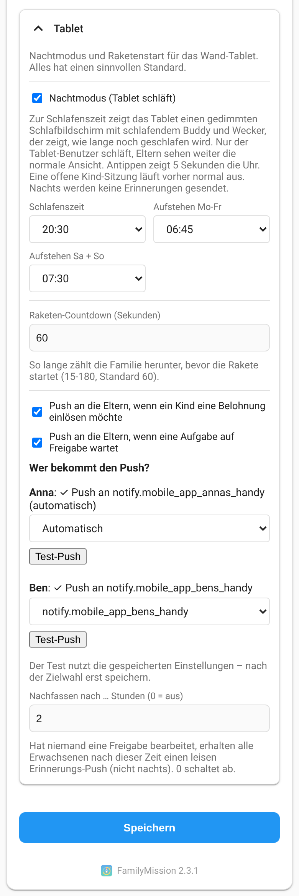<br>
  <em>Settings, section "Tablet": push target per adult with "Test push" and the reminder time.</em>
</p>

* **Quick-start catalog (2.3):** the room tasks `room_blitz`, `room_blitz_small` and `room_deep` are created with `requires_approval: true`. Re-running the wizard with "update earlier tasks" sets the flag only on wizard tasks that never had the key (created before 2.3); once the parents saved the task, their choice is kept.

Actionable notification (the companion app fires `mobile_app_notification_action`; FamilyMission handles the actions `FM_APPROVE_<id>`, `FM_NOTDONE_<id>`, `FM_CHEAT_<id>` itself):

```yaml
alias: Ask parents for approval
trigger:
  - platform: event
    event_type: family_mission_approval_requested
action:
  - service: notify.mobile_app_alexs_phone
    data:
      title: "{{ trigger.event.data.kid_name }}: {{ trigger.event.data.task_name }}"
      message: "{{ trigger.event.data.points }} points waiting for approval"
      data:
        tag: "to_{{ trigger.event.data.pending_id }}"
        actions:
          - action: "FM_APPROVE_{{ trigger.event.data.pending_id }}"
            title: "✅ Approve"
          - action: "FM_NOTDONE_{{ trigger.event.data.pending_id }}"
            title: "↩️ Not done"
          - action: "FM_CHEAT_{{ trigger.event.data.pending_id }}"
            title: "🚫 Cheated"
  # repeat the notify action for the second parent
---
alias: Clear the approval notification
trigger:
  - platform: event
    event_type: family_mission_approval_resolved
action:
  - service: notify.mobile_app_alexs_phone
    data:
      message: clear_notification
      data:
        tag: "to_{{ trigger.event.data.pending_id }}"
```

### Reward shop

Kids can spend their points on rewards chosen by the parents.

* **Wallet:** every point a kid earns (task, approval, team bonus, birthday bonus, manual bonus, "complete for kid") is also credited to a per-kid wallet (`wallet` in `get_data`). Penalties, undo and deleting/editing history entries debit it (never below 0). The wallet is **not** reset at the monthly reset, so the monthly points, goals and family goal work as before. On the first start with the shop the wallet is initialised with the current month points.
* **Rewards:** settings card or parents card (admins and managers: "Manage rewards"): emoji, name, cost (1-1000), minimum age and active flag, at most 30. "Load suggestions" adds a starter set. Command `family_mission/set_rewards`; `update_settings` and imports never touch rewards, wallet or redemptions.
* **Kids card:** a "🛍️ Shop" button in the kid view (hidden without active rewards) opens the shop: balance, rewards as cards (affordable ones highlighted, others with progress "noch 23 ⭐"), "Einlösen" with confirmation and a "⭐ Sparziel" toggle. The savings goal is shown as a small bar on the home tile. Redeeming (`kid_redeem`, PIN checked) deducts at once and creates a pending redemption.
* **Parents card:** section "Einlösungen" with "✅ Einlösen" (`redemption_resolve`, `approve: true`, marks it done) and "↩️ Ablehnen" (refunds the wallet, history type `refund`). The wallet balance is shown next to the monthly points. Redeem/refund history entries (`redeem`, `refund`) never change the monthly points.
* **Events:** `family_mission_reward_requested` (`redemption_id`, `kid_id`, `kid_name`, `reward_id`, `name`, `emoji`, `cost`) and `family_mission_reward_resolved` (same plus `result`: `approved` | `rejected`).

* **Push to the adults (2.1):** on every request FamilyMission itself pushes all adults who have a push target (same resolution as for the parent tasks: `parent_notify`, otherwise the Companion app): title "🎁 <kid> möchte einlösen", text "<reward> (<cost> ⭐)" and the actions `FM_RAPPROVE_<id>` ("Einlösen") / `FM_RREJECT_<id>` ("Ablehnen"). Once the request is handled, anywhere, no further push follows. Switch it off with the setting `reward_push` (`true` by default).

For additional announcements (the built-in push is enough for most families), an actionable notification of your own (`FM_RAPPROVE_<id>` / `FM_RREJECT_<id>`, idempotent like the approval actions):

```yaml
alias: Ask parents about a reward
trigger:
  - platform: event
    event_type: family_mission_reward_requested
action:
  - service: notify.mobile_app_alexs_phone
    data:
      title: "{{ trigger.event.data.kid_name }}: {{ trigger.event.data.emoji }} {{ trigger.event.data.name }}"
      message: "{{ trigger.event.data.cost }} points spent"
      data:
        actions:
          - action: "FM_RAPPROVE_{{ trigger.event.data.redemption_id }}"
            title: "✅ Redeem"
          - action: "FM_RREJECT_{{ trigger.event.data.redemption_id }}"
            title: "↩️ Decline (refund)"
```

### My tasks (own device, `mode: mine`)

For a phone or laptop that belongs to one person, set `mode: mine` on the kids card (or tick "My tasks" in the card editor). The card then identifies the viewer by the logged-in Home Assistant user: the person entity whose `user_id` equals the user is the participant. There is no home screen, no tiles and no PIN (the Home Assistant login is the proof).

* **Kid with a kid profile:** the kid view directly: due duties assigned to them, eligible bonus tasks, progress ring and the reward shop (if enabled). Approval rules, spot checks and strict mode apply as usual.
* **Adult without kid profile:** a plain list of their assigned due tasks (time windows respected), no ring, no shop, no approval.
* **No person linked to the user:** a hint to link the user to a person (Settings > People).

The card uses the websocket commands `my_complete_task`, `my_claim_task`, `my_redeem` and `my_set_goal`. They take **no** participant in the payload: the participant is always the calling user, so nobody can act for another person. The eligibility checks (assignment, age, time window, steps, routine lock) are the same as for `kid_complete_task`; helpers ("together") are not available. Errors: `unknown_kid` (no person / no kid profile for the user), `not_eligible`, `too_young`, `not_yet`, `too_late`, `steps_open`, `claimed`, `not_enough_points`, ...

### Task reminders

Tasks and templates have the optional fields `reminder_at` (`HH:MM`, local time) and `reminder_target` (`notify.<service>` or empty = only the event). In the task and template editor: switch "Reminder", a time select (15-minute steps) and a select with all `notify.*` services plus "Event only".

The minute timer fires, once per task and day, as soon as the time has passed, the task is due and still open (not paused or expired) and its time window has not ended yet:

* the event `family_mission_task_reminder` with `task_id`, `task_name`, `assignees` (participant ids) and `assignee_names`;
* if a target is set, the notify service is called with the title "Erinnerung" / "Reminder" (language of Home Assistant) and the message "<task> ist noch offen" / "<task> is still open". An unknown service is logged as a warning and does not stop anything.

```yaml
alias: Speak the reminder
trigger:
  - platform: event
    event_type: family_mission_task_reminder
action:
  - service: notify.mobile_app_alexs_phone
    data:
      message: "{{ trigger.event.data.task_name }}: {{ trigger.event.data.assignee_names | join(', ') }}"
```

### Bonus points and deductions
The websocket command `family_mission/adjust_points` (admin, manager or parent) (`kid_id`, `points` +-1..50, `reason` required, max 80 characters) and the service `family_mission.adjust_points` add a history entry of type `bonus` or `penalty` with the reason. A kid never drops below 0 points (the applied amount is recorded). History entries have an optional `type` (`task` for old entries, `bonus`, `penalty`, `birthday`) and `reason`; the protocol card shows them with icons, deleting a deduction refunds it. The type `missed` (0 points) marks an [expired duty](#missed-duties).

**Privacy:** deductions and strict mode are never shown on the kids card home screen, only in the kid's own view after the PIN (a neutral line like "-4 points: Cheated: Set the table" and a small note while strict mode is active).

**Family goal:** `family_points` (in `get_data`, used by the family rocket) is computed from this period's history entries of type `task`; birthday bonus, bonus points and deductions do not count.

### Parents card (`family-mission-parents`)
A phone-friendly hub for parents (administrators and users with the parents role, see [Parents role](#parents-role); other users only see a short note), in three tabs:

* **Today:** a yellow push hint while nobody can be reached (see [Parent approval](#parent-approval)), one compact row per kid (today's progress, wallet, open approvals), open approvals with the buttons Approve / Not done / Cheated (with a confirmation that shows the deduction), your own parent tasks, and quick +1 +5 -1 -5 per kid with a reason sheet.
* **Kids:** per kid the **❤️ Loben** button ([praise](#praise)), the **➕ Spontan-Bonus** button ([spontaneous bonus](#spontaneous-bonus)), the strict mode indicator and the latest history entries, where task entries have a **↩️ Rückgängig** button ([undo](#undo-parents)).
* **More:** [parent tasks](#we-parents-parent-tasks) (me / you / take turns), the task list, the [reward shop](#reward-shop) and, for administrators and managers, the settings, plus the in-app help.

<table align="center">
  <tr>
    <td align="center" valign="top"><br><em>Today</em></td>
    <td align="center" valign="top">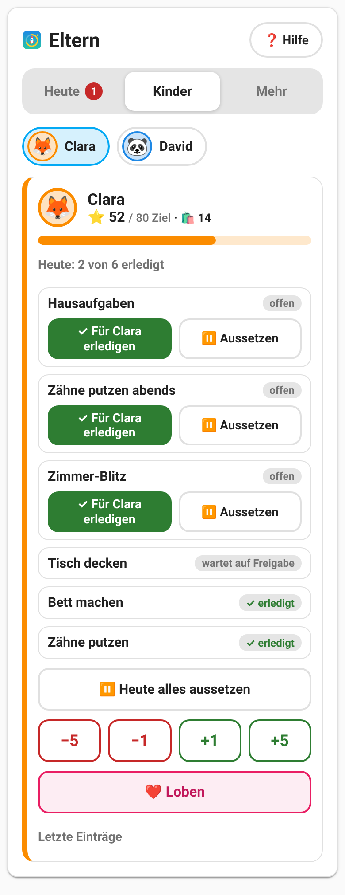<br><em>Kids</em></td>
    <td align="center" valign="top"><br><em>More: parent tasks</em></td>
  </tr>
</table>

**Dark mode:** the hub follows the Home Assistant theme.

<p align="center">
  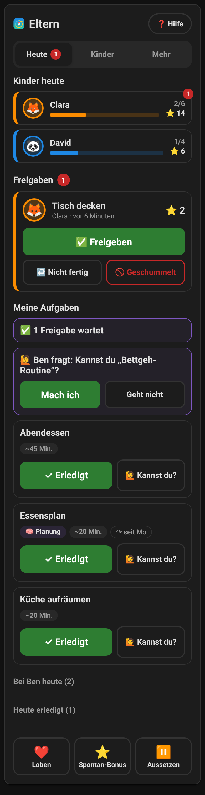<br>
  <em>Dark mode</em>
</p>

```yaml
type: custom:family-mission-parents
title: Parents
# optional: options of the cards embedded under "More"
tasks_card:            # same options as custom:family-mission-card
  sort_by: due_date
  filter_by: "!paused"
  items_per_page: 10
  show_search: true
  show_add: true
  show_edit: true
  show_delete: true
settings_card:         # same options as custom:family-mission-settings
  show_advanced: false
```

`tasks_card` and `settings_card` are optional; without them the embedded task list and settings use their defaults. A separate task list or settings card on the same dashboard is then no longer needed. Restrict the view that holds this card to the parents with `visible` (see [Recommended dashboard](#recommended-dashboard)).

### We parents (parent tasks)
New in 2.0. The household and planning work of the adults, set up once and then just ticked off. **No points, no ranking, no red.** Parent tasks live in the normal task list (`parent_task: true`, `category: basis`, `complexity: 0`, `generated_by: parents`) and never count for points, wallet, family goal or monthly goal; a completion writes a history entry of type `parent` with `points: 0` and `minutes`.

* **Set up:** the step "Wir Eltern" of the [quick-start wizard](#kids-mode-quick-start-wizard) (optional) or More > parent tasks in the parents' hub. A catalog of 28 templates in four groups (daily, weekly, monthly/rare, kids and family) with a small preselection.
* **Who:** per task *me*, *you* (the partner) or *take turns*. Responsibility switches to the other adult after each completion (relative to the responsible person, nobody keeps score). With more than two adults the picker asks once who "I" and "partner" are.
* **Quiet carry-over:** what is left at midnight silently moves to today (`carried_since` is set). No history entry, no push, no red display.
* **🧠 Planning tasks** (`planning: true`, e.g. meal plan, shopping list, calendar check) get one reminder the evening before they are due ("Morgen dran: Essensplan (ca. 20 Min.)"), by default at 18:00. Nothing else reminds.
* **"Kannst du?":** the responsible adult asks the partner to take a task. The partner gets a push with the actions `FM_TAKE_<task_id>` ("Mach ich") and `FM_DECLINE_<task_id>` ("Geht nicht"), handled by FamilyMission itself like the approval actions. Accepting applies to this one completion only; declining sends a short note to the asker.
* **Sunday summary:** on Sunday at 19:00 every adult with a push target gets a neutral note ("Diese Woche: Anna 6,5 Std. · Ben 4 Std. Liegengeblieben: Bäder, Fenster.").
* **Role-model band:** the kids tablet (family mode, not `mode: mine`) shows a quiet line "👪 Auch Mama und Papa haben heute N Missionen" with progress dots and no points whenever parent tasks are due or were done today. Parent tasks never appear in kid lists or on the bonus board.
* **Own device:** with `mode: mine` an adult sees their own parent tasks (no points, "~N Min.", 🧠 badge); ticking uses the normal `my_complete_task`, which the backend redirects to `parent_task_done`.

<p align="center">
  <br>
  <em>Quick start: choose parent tasks and who does them.</em>
</p>

#### Websocket commands
| Command | Payload / result |
| :--- | :--- |
| `family_mission/parents_catalog` | Returns `items` (template catalog), `adults` (`id`, `name`, `push`), `me`, `partner` and `existing` (`parent_key` -> `task_id`, `mode`). |
| `family_mission/parents_apply` | `items` (`[{key, mode}]`, mode `me` / `you` / `alternate`), optional `me`, `partner`. Creates the tasks; an existing `parent_key` only gets its mode updated (no duplicates). Without a partner `you` / `alternate` become `me`. Returns `{success, created, updated}`. |
| `family_mission/parent_task_set` | `task_id`, optional `mode`, `planning`, `minutes` (1-600), `me`. |
| `family_mission/parent_task_add` | A parent task without template: `name`, optional `minutes`, `planning`, `interval` (0-365, default 7; 0 = one time), `mode`, `me`. |
| `family_mission/parent_task_done` | `task_id`. Every adult / parent role may tick every parent task. The next due date is today + `interval`; with `interval: 0` the task is removed (undo restores it). Returns `{success, history_id}`; `undo_completion` works as usual. |
| `family_mission/handover_ask` | `task_id`, optional `to` (default: the partner of the responsible adult). Sends the push and fires `family_mission_handover_requested`. |
| `family_mission/handover_answer` | `task_id`, `accept`. Only the asked adult (or an admin). |
| `family_mission/weekly_summary` | The data of the Sunday summary (hours per adult over the last 7 days, carried-over tasks). |

`get_data` additionally returns `adults` (`id`, `name`, `push`), `me` and `partner`.

#### Settings (`update_settings`)
| Key | Default | Meaning |
| :--- | :--- | :--- |
| `role_model_band` | `true` | Show the role-model band on the kids tablet. |
| `role_model_label` | empty | Wording ("Mama und Papa" / "Mom and Dad" when empty). |
| `weekly_summary` / `weekly_summary_time` | `true` / `"19:00"` | Sunday summary on or off and its time. |
| `planning_reminders` / `planning_reminder_time` | `true` / `"18:00"` | Evening-before reminder for 🧠 planning tasks and its time. |
| `parent_notify` | `{}` | Optional push target per adult (`{user_id: "notify.xyz"}`). Without an entry FamilyMission uses the `mobile_app` notify service of that user's device, if it exists. Send errors are only logged. |

All of them are in the settings card, section **Wir Eltern**; none is required.

### Rocket launch and night mode

Both features only concern the wall tablet (`family-mission-kids` in family mode); the own-device view (`mode: mine`) is never affected.

<table align="center">
  <tr>
    <td align="center" valign="top"><br><em>Rocket countdown</em></td>
    <td align="center" valign="top"><br><em>Night mode</em></td>
  </tr>
</table>

#### Rocket launch (family goal reached)
* As soon as the approved task points of the family reach the family goal (`family_goal.points`), the backend remembers it once per period (`rocket` in `get_data`: `period`, `reached_at`, `launched_at`), fires `family_mission_rocket_ready` and pushes all adults: "🚀 Familienziel erreicht! Belohnung: <reward> – jetzt gemeinsam einplanen." Taking points back later does not undo it; the next period (monthly reset) can launch again.
* The kids tablet then shows a full-screen overlay: "Alle zur Rakete! 🚀", the reward, a countdown of `rocket_countdown` seconds (default 60), a call sound every 10 seconds (only with `sound: true`), huge numbers with a tick in the last 10 seconds and a button "Jetzt starten!" that skips the rest. Then the rocket lifts off with flames, smoke, stars, fireworks and a fanfare (about 8 s), followed by "Geschafft, Familie! 🎉 <reward>" for about 6 s. A tap after the launch closes it early. With `prefers-reduced-motion` a calmer variant (no shaking, smoke or fireworks) is used.
* The overlay starts on the first tablet that loads the data (even over a finished kid session) and calls `family_mission/rocket_countdown` once. Whoever finishes first calls `family_mission/rocket_launched`; other tablets play to the end. Afterwards the family bar shows "🚀 gestartet! <reward>" instead of "Ziel erreicht!".
* A goal reached at night waits for the morning (see night mode).

#### Night mode
* From `night_sleep` the tablet shows a dark sleep screen: a sleeping moon buddy with a nightcap (slow breathing, rising "Z z z") next to an analogue alarm clock (hour and minute hand show the time, a coloured hand the wake-up time, an arc the remaining sleep). Texts: "Gute Nacht, Clara & David 💤" until midnight, "Psst … alle schlafen" afterwards, "Gleich ist Morgen!" for the last 30 minutes (the buddy blinks now and then), then "Ich schlafe noch 7 Std. 30 Min." and "Aufstehen um 06:00". No tasks, no PIN pad, no sounds, no confetti, no animation loop (updated once a minute, slow CSS animation only, none with `prefers-reduced-motion`). A tap brightens the screen for 5 seconds and the alarm clock wobbles.
* When the tablet wakes from standby (page visible again / window focus) the night state is re-checked immediately, so the screen never shows a stale "Gute Nacht" after the wake-up time.
* It sleeps until the wake-up time of the **following** day: `night_wake_weekday` for Mon-Fri, `night_wake_weekend` for Sat+Sun (so Friday night wakes at the weekend time, Sunday night at the weekday time). Browser local time.
* A kid session that is still open at bedtime runs out normally (idle `timeout`) and is never cut off in the middle of an input; then the tablet sleeps. After waking up a "Guten Morgen ☀️" banner stays for 30 minutes (tap to dismiss).
* The backend sends no reminders (`reminder_at`) for kid tasks during the night.
* Only users **without** a parent role sleep (the shared tablet user, kids with an own login). Admins, managers and parents keep the normal view on their own devices, e.g. to approve something in the evening. So the tablet user must not be an administrator.
* The time logic is the small pure function `kidsNightState(now, options)` in `family-mission-kids.js` (returns `sleeping`, `morning`, `wakeAt`, `wakeDate`, `minutesLeft` and `phase` = `evening` / `night` / `soon`) (also `customElements.get('family-mission-kids').nightState`), so it can be tested with a fake clock.

#### Settings (`update_settings`)
| Key | Default | Meaning |
| :--- | :--- | :--- |
| `night_mode` | `true` | Night mode on or off. |
| `night_sleep` | `"20:30"` | Bedtime (`HH:MM`). |
| `night_wake_weekday` | `"06:00"` | Wake-up time Mon-Fri. |
| `night_wake_weekend` | `"08:00"` | Wake-up time Sat+Sun. |
| `rocket_countdown` | `60` | Length of the rocket countdown in seconds (15-180). |
| `approval_push` | `true` | Push to the adults when a task waits for parent approval (see [Parent approval](#parent-approval)). |
| `approval_reminder_hours` | `2` | Hours after which an open approval gets one quiet reminder push (integer 0-24, `0` = off; not at night). |
| `reward_push` | `true` | Push to the adults when a kid requests a redemption (see [Reward shop](#reward-shop)). |

The first five are in the settings card, section **Tablet**; invalid values fall back to the default.

#### Websocket commands
| Command | Description |
| :--- | :--- |
| `family_mission/rocket_countdown` | Any logged-in session (also a tablet user). Remembers `countdown_started_at` once and fires `family_mission_rocket_countdown`. |
| `family_mission/rocket_launched` | Any logged-in session. Sets `launched_at` (idempotent) and fires `family_mission_rocket_launched`. |

For a speaker announcement of the countdown see [`examples/kids/automationen.yaml`](examples/kids/automationen.yaml).

### Praise
Social recognition without points. On the parents card every kid has a **❤️ Loben** button: a sheet with sticker chips (❤️ ⭐ 🌟 👏 🏆 💪 🦸 🎉 😊 🙌), message chips ("Danke fürs Helfen!", "Das hast du super gemacht!", "Ich bin stolz auf dich!", "Toll, wie du drangeblieben bist!") and a free text (max 120 characters). The websocket command `family_mission/send_praise` (`kid_id`, `sticker`, optional `message`; admin, manager or parent) stores the praise in `data["praise"]` (the last 50 per kid; `id`, `kid_id`, `from_name`, `message`, `sticker`, `timestamp`, `seen`), where `from_name` is the name of the person linked to the sending user (else the user name), adds a history entry of type `praise` with 0 points (protocol card: ❤️ and the message; statistics and goals ignore it) and fires `family_mission_praise`.

On the kids card unseen praise shows as a small bouncing sticker on **that kid's** home tile only (no comparison between siblings). When the kid opens their view (after the PIN, or on the own device with `mode: mine`) a big friendly overlay shows sticker, message and "von <name>" with a gentle sound (setting `sound`); closing it calls `kid_praise_seen` (`kid_id`, `pin`, `praise_id`) or `my_praise_seen` (`praise_id`) and marks it as seen. A kid can only mark its own praise.

#### Event `family_mission_praise`
Data: `kid_id`, `kid_name`, `from_name`, `message`, `sticker`. Example: read the praise out on the Fully Kiosk tablet (media player of the Fully Kiosk Browser integration):

```yml
alias: "FamilyMission: Read out praise on the tablet"
trigger:
  - platform: event
    event_type: "family_mission_praise"
action:
  - action: tts.speak
    target:
      entity_id: tts.home_assistant_cloud      # your TTS entity
    data:
      media_player_entity_id: media_player.tablet_kitchen   # the Fully Kiosk media player
      message: >
        {{ trigger.event.data.kid_name }}, a message from {{ trigger.event.data.from_name }}:
        {{ trigger.event.data.message }}
```

### Parents role

By default every parent action needs a Home Assistant administrator. With the **parents role** a normal (non-admin) Home Assistant user can be a parent without full admin rights. An administrator configures it in the settings card under **Kids > Parents**: tick **Parent** and, if wanted, **May manage** per user (listed are the persons that have a Home Assistant user; "may manage" implies parent). The lists are stored as the settings `parents` and `parents_manage` and can only be changed by an administrator with the admin-only websocket command `family_mission/set_parents` (`parents`, `parents_manage`; unknown, inactive and system users are rejected with `invalid_user`). `update_settings` and imports ignore both keys. **Do not enter the tablet user** of the kids card: it would be allowed to approve its own tasks.

| Role | Allowed |
| --- | --- |
| Administrator (HA admin) | everything, including `set_parents` |
| Manager (`parents_manage`) | everything of a parent plus `set_kid_profile` (incl. PINs), `delete_kid_profile`, `wizard_catalog` / `wizard_preview` / `wizard_apply`, `set_bonus_triggers`; sees the Kids section and the wizard in the settings card |
| Parent (`parents`) | `approve`, `reject`, `adjust_points`, `undo_completion`, `add_adhoc_bonus`, `parent_task_action`, `parent_complete_for`; parents card and undo in the protocol card; sees the settings read-only |
| Anyone else | none of the above (error `unauthorized`) |

`get_data` returns `my_role` (`admin`, `manager`, `parent` or `null`) for the calling user and `ha_users` (persons with a user: `user_id`, `name`) for the settings card. Services such as `family_mission.adjust_points` stay Home Assistant admin-level, and actionable push notifications are unchanged.

**Classic commands while kids mode is in use.** As soon as at least one kid profile exists, the classic websocket commands are role-gated too, so the shared tablet user can only use the PIN-protected kid commands:

| Command | Allowed for |
| :--- | :--- |
| `complete_task`, `add_task`, `edit_task`, `delete_task`, `add_template`, `edit_template`, `delete_template`, `delete_history_item`, `edit_history_item` | admin, manager, parent |
| `update_settings` | admin, manager |
| `import_tasks`, `factory_reset` | admin |

Without kid profiles nothing changes: every Home Assistant user may manage tasks, templates, settings and history as before. Note that the button entities (`button.family_mission_reset_month`, `button.family_mission_factory_reset`) and the services are not covered by these checks; hide or disable the factory reset button if non-admin users can reach entity controls.

### Settings of step 2
`cheat_penalty_factor` (0-2), `cheat_strict_days` (0-30), `birthday_bonus_points` (0-50), `team_bonus` (0-3), `birthday_duty_free`, `expire_missed` and the per-kid spot-check rate are in the settings card (Kids). `update_settings` cannot overwrite kid profiles, pending approvals, history or points.

### Security notes
* PINs are stored as salted SHA-256 hashes. The hashes are never sent to the frontend (`family_mission/get_data` only reports `has_pin`) and never appear in the attributes of `sensor.family_mission_settings`.
* The PIN is a *convenience barrier between siblings*, not a security feature against attackers: the kids card talks to Home Assistant with the permissions of the logged-in tablet user, so that user must not be an administrator. The regular task card and the other websocket commands are not PIN-protected.
* Brute-force protection is kept in memory (a restart of Home Assistant unlocks the kids).

## Sensors
The integration provides the following sensors:

| Sensor | Description |
| :--- | :--- |
| `sensor.family_mission_all_tasks` | Displays the total number of created tasks. The full task list (including subtasks) is available as JSON in the attributes. |
| `sensor.family_mission_due_tasks` | Displays the number of tasks that are due but not yet overdue. |
| `sensor.family_mission_overdue_tasks` | Displays the number of overdue tasks. |
| `sensor.family_mission_due_and_overdue_tasks` | Displays the combined number of due and overdue tasks. |
| `sensor.family_mission_points` | Shows the current point standings for all users. Perfect for custom visualizations. |
| `sensor.family_mission_templates` | Displays the number of available templates. The full template list (including subtasks) is available as JSON in the attributes. |
| `sensor.family_mission_settings` | Provides the current configuration (colors, overdue thresholds, kid profiles without PIN hashes). |

## Buttons
| Button | Description |
| :--- | :--- |
| `button.family_mission_reset_month`| Triggers the monthly reset (archives points and starts a new period). |
| `button.family_mission_factory_reset` | Performs a factory reset (deletes all data). |

## Services
FamilyMission offers services that can be used in automations or scripts:

### `family_mission.add_task`
Creates a new recurring or one-time task, optionally from a template.
* **template**: (Optional) The name of a template to use. Fills in other fields if they are not provided.
* **name**: (Optional if template is used) What should the task be called?
* **description**: (Optional) Additional info.
* **area**: (Optional) The area/room where the task applies.
* **interval**: (Optional) How often does it need to be done? `0` for one-time tasks. If not set, taken from template or defaults to `7`.
* **complexity**: (Optional) Points (1-10).
* **icon**: (Optional) An mdi-icon for the task (e.g., `mdi:broom`).
* **category**: (Optional) Kids mode category: `basis` (default), `bonus` or `auftrag`. Taken from the template if not set.
* **min_age**: (Optional) Minimum age in years for kids (0-18, default 0). Taken from the template if not set.
* **available_from** / **available_until**: (Optional) Kids mode [time window](#time-windows) as `HH:MM`. Taken from the template if not set.
* **assignees**: (Optional) List of user IDs or person entities.
* **override_overdue_days**: (Optional) Overrides the global setting for the number of days after which this task is considered overdue.
* **subtasks**: (Optional) A list of subtasks (objects with 'title' and 'done' keys).

### `family_mission.complete_task_by_name`
Marks a task as completed by its exact name.
* **task_name**: The name of the task.
* **user_id**: (Optional) Who completed the task.

### `family_mission.set_task_due_by_name`
Marks a task as due immediately by its exact name.
* **task_name**: The name of the task.

### `family_mission.pause_task_by_name`
Pauses a task until a specific date.
* **task_name**: The name of the task.
* **pause_until**: The date until which the task should be paused (e.g., "2024-12-31").

### `family_mission.remove_task_by_name`
Removes a task by its exact name.
* **task_name**: The exact name of the task.

### `family_mission.edit_task_by_name`
Edits an existing task by its exact name.
* **task_name**: The exact name of the task to edit.
* **new_name**: (Optional) The new name for the task.
* **description**: (Optional) Additional info.
* **area**: (Optional) The area/room where the task applies.
* **interval**: (Optional) How often does it need to be done?
* **complexity**: (Optional) Points (1-10).
* **icon**: (Optional) An mdi-icon for the task.
* **category**: (Optional) `basis`, `bonus` or `auftrag`.
* **min_age**: (Optional) Minimum age in years for kids (0-18).
* **assignees**: (Optional) List of user IDs or person entities.
* **override_overdue_days**: (Optional) Overrides the global setting.
* **subtasks**: (Optional) The updated list of subtasks.

### `family_mission.add_template`
Creates a new template.
* **name**: The name of the template.
* **description**: (Optional) Additional info.
* **area**: (Optional) The area/room where the task applies.
* **interval**: (Optional) How often does it need to be done?
* **complexity**: (Optional) Points (1-10).
* **icon**: (Optional) An mdi-icon for the task.
* **category**: (Optional) `basis` (default), `bonus` or `auftrag`.
* **min_age**: (Optional) Minimum age in years for kids (0-18, default 0).
* **assignees**: (Optional) List of user IDs or person entities.
* **subtasks**: (Optional) A list of subtasks for this template.

### `family_mission.remove_template_by_name`
Removes a template by its exact name.
* **template_name**: The exact name of the template.

### `family_mission.edit_template_by_name`
Edits an existing template by its exact name.
* **template_name**: The exact name of the template to edit.
* **new_name**: (Optional) The new name for the template.
* **description**: (Optional) Additional info.
* **area**: (Optional) The area/room where the task applies.
* **interval**: (Optional) How often does it need to be done?
* **complexity**: (Optional) Points (1-10).
* **icon**: (Optional) An mdi-icon for the task.
* **category**: (Optional) `basis`, `bonus` or `auftrag`.
* **min_age**: (Optional) Minimum age in years for kids (0-18).
* **assignees**: (Optional) List of user IDs or person entities.
* **subtasks**: (Optional) The updated list of subtasks.

### `family_mission.reset_monthly_points`
Manually resets all points to 0 and saves the current month to the history.

### `family_mission.factory_reset`
Deletes all tasks, history, and points, returning the integration to its initial state.

## Events
FamilyMission fires custom events to allow for advanced automations.

### family_mission_task_completed
This event is fired whenever a task is marked as completed. It is useful for triggering notifications or other household automations.

#### Event Data:
- **task_id**: The unique ID of the task.
- **task_name**: The name of the task (e.g., "Take out the trash").
- **completed_by**: A list of user IDs who completed the task.
- **points_per_user**: Points awarded to each participant.
- **total_points**: Total complexity points of the task.

#### Example Automation:
Say "Thank you" via a media player when someone completes a specific task.

```yml
alias: "FamilyMission: Thank You Message"
trigger:
  - platform: event
    event_type: "family_mission_task_completed"
condition:
  - condition: template
    value_template: "{{ trigger.event.data.task_name == 'Take out the trash' }}"
action:
  - service: tts.google_translate_say
    data:
      entity_id: media_player.living_room_speaker
      message: "Thank you for taking out the trash!"
```

### family_mission_handover_requested
Fired when an adult asks the partner to take over a parent task ("Kannst du?"). The push with the actions `FM_TAKE_<task_id>` / `FM_DECLINE_<task_id>` is sent by FamilyMission itself; use the event for additional announcements.

#### Event Data:
- **task_id**: The ID of the parent task.
- **task_name**: The name of the task.
- **from**: The participant ID of the asking adult.
- **to**: The participant ID of the asked adult.

### family_mission_weekly_summary
Fired together with the Sunday summary push. The event data are the same as the websocket command `family_mission/weekly_summary` returns: the hours per adult over the last 7 local days and the parent tasks that were carried over.

### family_mission_rocket_ready
Fired once per period when the family goal is reached (together with the push to the adults).

#### Event Data:
- **reward**: The reward text of the family goal.
- **points**: The goal in points.
- **period**: The period (month) the goal was reached in.

### family_mission_rocket_countdown
Fired when the rocket countdown starts on a tablet (`family_mission/rocket_countdown`). Use it for a speaker announcement.

#### Event Data:
- **seconds**: The length of the countdown in seconds.
- **reward**: The reward text.

### family_mission_rocket_launched
Fired when a tablet reports the finished launch (`family_mission/rocket_launched`, idempotent).

### family_mission_task_created
This event is fired whenever a new task is created. It is useful for notifying family members about new tasks or triggering other automations.

#### Event Data:
- **id**: The unique ID of the newly created task.
- **name**: The name of the task.
- **description**: Additional info about the task.
- **area**: The area/room where the task applies.
- **interval**: The interval of the task in days (0 for one-time tasks).
- **assignees**: A list of user IDs or person entities assigned to the task.
- **complexity**: Points (1-10) for the task.
- **category**: The category of the task (`basis`, `bonus` or `auftrag`).
- **min_age**: Minimum age in years for kids (0 = no restriction).
- **icon**: The mdi-icon for the task.
- **due_date**: The initial due date of the task.
- **paused_until**: Date until the task is paused (if applicable).
- **override_overdue_days**: Custom overdue threshold for the task (if applicable).
- **subtasks**: A list of subtasks for the task.

#### Example Automation:
Send a notification when a new high-complexity task is created.

```yml
alias: "FamilyMission: New High-Complexity Task Notification"
trigger:
  - platform: event
    event_type: "family_mission_task_created"
condition:
  - condition: template
    value_template: "{{ trigger.event.data.complexity >= 8 }}"
action:
  - service: notify.notify
    data:
      title: "Important New Task!"
      message: "A new difficult task '{{ trigger.event.data.name }}' has been added."
```

### family_mission_bonus_opened
This event is fired when a [bonus trigger](#bonus-triggers) opened a bonus task (the observed entity changed to the configured state).

#### Event Data:
- **task_id**: The ID of the bonus task.
- **task_name**: The name of the task.
- **points**: The points (1-10) of the task.

#### Example Automation:
Announce the open bonus task on the wall tablet (Fully Kiosk Browser integration, which provides a `media_player` for the tablet):

```yml
alias: "FamilyMission: Announce bonus task on the tablet"
trigger:
  - platform: event
    event_type: "family_mission_bonus_opened"
action:
  - action: tts.speak
    target:
      entity_id: tts.home_assistant_cloud      # your TTS entity
    data:
      media_player_entity_id: media_player.tablet_kitchen   # the Fully Kiosk media player
      message: >
        New bonus task: {{ trigger.event.data.task_name }}.
        {{ trigger.event.data.points }} points for the first one!
```

### family_mission_reset
This event is fired when the monthly points reset occurs (either automatically at the start of a month or manually via service).

#### Event Data:
- **month**: The month string (e.g., "2024-05").
- **winner_name**: Friendly name of the user with the most points.
- **winner_points**: Total points achieved by the winner.
- **all_scores**: List of all users with `user_id`, `name`, and `points`, sorted descending by points.

#### Example Automation:
Announce the winner and list the scores of all participants after a reset.

```yml
alias: "FamilyMission: Winner Announcement"
trigger:
  - platform: event
    event_type: "family_mission_reset"
action:
  - action: notify.persistent_notification
    data:
      title: "Statistics Reset ({{ trigger.event.data.month }})"
      message: >
        Winner of the month: {{ trigger.event.data.winner_name }} with {{ trigger.event.data.winner_points }} points.
        Other scores: 
        
          {{ entry.name }} {{ entry.points }}{{ ", " if not loop.last else "" }}
        
```


## Installation & Data Storage
All data is stored in the internal Home Assistant storage at `.storage/family_mission.storage`.

Colors and overdue thresholds can be defined globally within the settings card.

## Credits and license
FamilyMission is based on [TaskOrganizer](https://github.com/patrickvonwiegen/TaskOrganizer) by Patrick von Wiegen (MIT). Maintained by [AndyKausG](https://github.com/AndyKausG). Released under the [MIT license](LICENSE) (copyright Patrick von Wiegen and AndyKausG).
